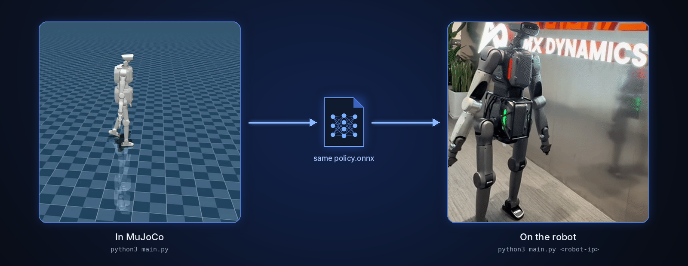

<!--
  SPDX-FileCopyrightText: 2024-2026 LimX Dynamics Technology Co., Ltd.
  SPDX-License-Identifier: Apache-2.0
-->

<p align="center">
  
</p>

<p align="center">
  <b>English</b> | <a href="README_zh-CN.md">中文</a>
</p>

<p align="center">
  <a href="https://github.com/limxdynamics/tron2_rl_deploy_python/actions/workflows/ci.yml"></a>
  <a href="LICENSE"></a>
  
  
  
</p>

# tron2-rl-deploy-python

> **Distribution.** The primary public distribution point for this
> repository is GitHub:
> <https://github.com/limxdynamics/tron2_rl_deploy_python>. The internal
> LimX GitLab is a mirror; open issues, PRs, and security reports on
> the GitHub repository.

Reinforcement-learning **deployment / inference** stack (Python) for
the TRON2A humanoid — Sole-Foot (`SF_TRON2A`), Wheel-Foot
(`WF_TRON2A`), and dual-arm Sole-Foot (`DASF_TRON2A`) variants. Loads ONNX policies via `onnxruntime` and
drives joint targets through the LimX low-level SDK, either against
the MuJoCo simulator or against a physical robot.

## Highlights

- **Three robots, one entry point.** `main.py` picks the SF, WF or DA-SF
  controller from `ROBOT_TYPE`.
- **Sim and robot from the same command.** No argument connects to a local
  MuJoCo simulator; `python3 main.py <robot-ip>` drives the robot.
- **Policies included.** Policy and history encoder ONNX files for all three
  variants ship in `controllers/model/`; see [`MODEL_CARD.md`](MODEL_CARD.md).
- **Gamepad direct or through the SDK.** A Logitech F710 is read through
  pygame; without it the controller falls back to SDK `SensorJoy`.
- **Dry run before the real thing.** `python3 main.py <robot-ip> --dry-run`
  (SF / WF) checks and prints joint commands without sending them.

## Supported robots

| | Model | Description | Joints / policy actions | Format |
|:-:|---|---|:-:|---|
|  | `SF_TRON2A` | Biped with sole feet | 10 / 10 | ONNX policy + encoder |
|  | `WF_TRON2A` | Biped with wheel feet | 10 / 10 | ONNX policy + encoder |
|  | `DASF_TRON2A` | Sole-foot biped with two arms, driven through the Centaur SDK | 26 / 20 | ONNX policy + encoder |

## How it works

<p align="center">
  
</p>

## Quick start

In simulation, with [tron2_mujoco_sim](https://github.com/limxdynamics/tron2_mujoco_sim)
running `ROBOT_TYPE=SF_TRON2A uv run simulator.py` in another terminal:

```bash
git clone --recurse-submodules https://github.com/limxdynamics/tron2_rl_deploy_python.git
cd tron2_rl_deploy_python
pip install numpy scipy pyyaml onnxruntime pygame
pip install limxsdk-lowlevel/python3/amd64/limxsdk-*.whl
export ROBOT_TYPE=SF_TRON2A
python3 main.py
```

On the gamepad, press `L1 + B` to stand, then `L1 + Y` to walk; the left
stick moves the robot and the right stick turns it.

## 1. Directory layout

- `main.py`: controller entry point (auto-selects the SF / WF
  / DA-SF controller based on `ROBOT_TYPE`).
- `controllers/SolefootController.py`: `SF_TRON2A` inference and
  control logic.
- `controllers/WheelfootController.py`: `WF_TRON2A` inference and
  control logic.
- `controllers/DASFController.py`: `DASF_TRON2A` dual-channel Centaur SDK
  inference and control logic.
- `controllers/model/<ROBOT_TYPE>/`: per-variant model and
  configuration directory.
- `limxsdk-lowlevel/`: LimX SDK sources and examples.

## 2. Environment setup

### Step 1: Install Python dependencies

```bash
pip install -U pip
pip install numpy scipy pyyaml onnxruntime pygame
```

### Step 2: Install the LimX SDK (required)

Install the wheel that matches your system architecture:

```bash
git clone https://github.com/limxdynamics/limxsdk-lowlevel.git

# x86_64 example
pip install limxsdk-lowlevel/python3/amd64/limxsdk-*.whl

# aarch64 example
pip install limxsdk-lowlevel/python3/aarch64/limxsdk-*.whl
```

## 3. Model file placement rules

Model files must be placed per robot variant at:

- `controllers/model/SF_TRON2A/policy.onnx`
- `controllers/model/SF_TRON2A/encoder.onnx`
- `controllers/model/SF_TRON2A/params.yaml`
- `controllers/model/WF_TRON2A/policy.onnx`
- `controllers/model/WF_TRON2A/encoder.onnx`
- `controllers/model/WF_TRON2A/params.yaml`
- `controllers/model/DASF_TRON2A/policy.onnx`
- `controllers/model/DASF_TRON2A/encoder.onnx`
- `controllers/model/DASF_TRON2A/params.yaml`

## 4. Running the controller

### Step 1: Enter the directory and set the robot variant

```bash
cd tron2_rl_deploy_python
export ROBOT_TYPE=SF_TRON2A
# or: export ROBOT_TYPE=WF_TRON2A
# or: export ROBOT_TYPE=DASF_TRON2A
```

### Step 2: Launch the controller

By default, connect to a local simulator (`127.0.0.1`):

```bash
python3 main.py
```

Specify a robot or SDK target IP:

```bash
# NOTE: <robot-ip> is a placeholder token — substitute your own
# robot / simulator IP before running. Nothing in this repo's
# source hard-codes a private IP. (The internal-only sibling
# tron2-rl-deploy-ros retains a documentation-example literal
# 10.192.1.2 in its source / launch files, declared in that
# repo's SECURITY.md.)
python3 main.py <robot-ip>
```

## 5. Working with the MuJoCo simulator

Make sure the simulator side and the controller side use the same
`ROBOT_TYPE`:

- Simulator side: `simulator.py` in [tron2_mujoco_sim](https://github.com/limxdynamics/tron2_mujoco_sim)
- Controller side: `tron2-rl-deploy-python/main.py`

We recommend starting the simulator first, then the controller.

For DA-SF, start the tron2_mujoco_sim simulator, then run:

```bash
export ROBOT_TYPE=DASF_TRON2A
python3 main.py
```

DA-SF lower/upper motor state, commands, IMU, and remote gamepad input all use
the Centaur SDK. The controller reads an F710 directly through pygame by
default and falls back to SDK `SensorJoy` when pygame or a gamepad is
unavailable. The default IP `127.0.0.1` connects to a local simulator; a
non-loopback robot IP always enables the real-hardware joint transform (thigh
yaw zero offsets and reversed knee/ankle-pitch directions). A local-loopback
MuJoCo target does not use that transform.

## 6. Gamepad control notes

- `L1 + B` (`○`): STAND, interpolate from the current pose to the default pose
- `L1 + Y` (`△`): WALK, start the policy
- `L1 + A` (`×`): IDLE, joints held with damping only
- `R1`: clear velocity command and policy history

Button indices follow the F710 in `X` mode (`A`=0, `B`=1, `X`=2, `Y`=3,
`L1`=4, `R1`=5); see `JOY_BTNS` in the controllers.

Connect the F710 in `X` mode and run `main.py`. A startup message containing
`Direct joystick ready: Logitech Gamepad F710` confirms direct input, and
`robot-joystick` is not needed.

If startup instead reports `Joystick source: limxsdk SensorJoy`, run the
gamepad publisher in another terminal:

```
../tron2_mujoco_sim/robot-joystick/robot-joystick
```

Press `L1 + B` and wait for the default pose, then press `L1 + Y`. The three
joystick axes are scaled by `commands.max` in
`controllers/model/DASF_TRON2A/params.yaml`.

## 7. Screenshots / GIFs

### MuJoCo simulation deployment


### Real-world deployment

Suspend the robot before starting the controller when deploying on
real hardware.


## 8. FAQ

- `ROBOT_TYPE not set`: run `export ROBOT_TYPE=...` first.
- `Model not found`: check that all files are present under
  `controllers/model/<ROBOT_TYPE>/`.
- `No module named limxsdk`: the SDK wheel is not installed in the
  current Python environment.
- `RobotState has not been received yet`: usually means the
  simulator is not running, or the two sides have mismatched
  `ROBOT_TYPE`.

---

## Verification

The commands below are the same ones CI runs (see
[`.github/workflows/ci.yml`](.github/workflows/ci.yml)); running them
locally before opening a PR saves review round-trips. None of them
require a physical robot.

```bash
# 1. Byte-compile every Python file (catches syntax errors,
#    does not require the SDK wheel).
python -m compileall -q main.py controllers/

# 2. Lint (recommended).
pip install ruff
ruff check .

# 3. Dry-run import — exercises module-level side effects without
#    calling robot.init. Requires the LimX SDK wheel installed.
python -c "import controllers"

# 4. YAML sanity for every params file.
python -c "import yaml, glob
for p in glob.glob('controllers/model/*/params.yaml'):
    yaml.safe_load(open(p)); print('OK', p)"

# 5. ONNX sanity (loads the graph; does not run inference).
python -c "import onnx, glob
for p in glob.glob('controllers/model/*/*.onnx'):
    onnx.checker.check_model(onnx.load(p)); print('OK', p)"
```

### Sim-only mode

Before ever running against a physical robot, verify the full
control loop against the LimX MuJoCo simulator:

1. Start the simulator (`simulator.py` in tron2_mujoco_sim) with the
   same `ROBOT_TYPE` you plan to use.
2. Leave the controller's target IP at its default `127.0.0.1`
   (this is what `main.py` uses when no argument is passed).
3. Run `python3 main.py` and confirm the observation stream, action
   outputs, and joystick binds all behave as expected in
   simulation.

Only after sim-only verification passes should you consider a
real-hardware run — and only with the robot suspended / mounted,
per [`SECURITY.md`](SECURITY.md#real-hardware-safety-notice).

---

## Cite & support

If you use this deployment stack in academic or public work, please
cite the repository:

```
@misc{limx_tron2_rl_deploy_python_2026,
  title  = {tron2-rl-deploy-python: TRON2 RL deployment (Python)},
  author = {LimX Dynamics},
  year   = {2026},
  howpublished = {\url{https://github.com/limxdynamics/tron2_rl_deploy_python}}
}
```

- **Bug reports, feature requests and questions:**
  [GitHub Issues](https://github.com/limxdynamics/tron2_rl_deploy_python/issues).
- **Security reports / robot-safety incidents:** email
  `contact@limxdynamics.com`; see [`SECURITY.md`](SECURITY.md).
- **Company / commercial contact:** <https://www.limxdynamics.com>.

## License & attribution

This project is licensed under the **Apache License, Version 2.0**
(January 2004). See the [`LICENSE`](LICENSE) file for the full text.
SPDX identifier: `Apache-2.0`.

- [`NOTICE`](NOTICE) — required attribution notice.
- [`THIRD_PARTY_NOTICES.md`](THIRD_PARTY_NOTICES.md) — per-item
  provenance for the checked-in ONNX weights, the
  `limxsdk-lowlevel` submodule, Python runtime dependencies
  (`onnxruntime`, `numpy`, `scipy`, `pyyaml`, `pygame`), and
  documentation media.
- [`MODEL_CARD.md`](MODEL_CARD.md) — model cards for all six SF/WF/DASF
  ONNX files.
- [`SECURITY.md`](SECURITY.md) — how to report a vulnerability,
  plus the real-hardware safety notice.
- [`CONTRIBUTING.md`](CONTRIBUTING.md) — dev setup (`pip`, `ruff`),
  verification steps, DCO sign-off, and the model-provenance rule.
- [`CHANGELOG.md`](CHANGELOG.md) — release notes and pending owner
  sign-off items.

## Scope

**Included** in this repository:

- Python controller entry point (`main.py`) and per-variant
  controllers (`controllers/SolefootController.py`,
  `controllers/WheelfootController.py`, and
  `controllers/DASFController.py`).
- Runtime configuration (`controllers/model/*/params.yaml`).
- Six ONNX inference blobs (`policy.onnx`, `encoder.onnx` for
  `SF_TRON2A`, `WF_TRON2A`, and `DASF_TRON2A`) — **pending
  provenance sign-off**;
  see [`MODEL_CARD.md`](MODEL_CARD.md) and
  [`THIRD_PARTY_NOTICES.md`](THIRD_PARTY_NOTICES.md) §2.
- Vendor SDK **submodule reference** (`limxsdk-lowlevel/`) —
  **pending SDK owner / legal clearance**; do not move the pin
  without written sign-off.

**Not included** — by design:

- No PyTorch / training checkpoints (`.pt`, `.pth`, `.ckpt`,
  `.safetensors`).
- No SDK binaries (`.so`, `.dll`, `.dylib`, `.lib`, `.whl`) — install
  the LimX SDK wheel yourself from the vendored `limxsdk-lowlevel/`
  submodule.
- No firmware, no factory calibration values, no per-serial
  calibration files.
- No rosbag / MCAP / trajectory captures.
- No customer- or site-specific configuration.
- **No pre-baked robot IP.** The `<robot-ip>` token used in the
  §4 examples below is a **placeholder** — substitute your own
  robot or simulator address before running. Nothing in this
  repository's source hard-codes a private IP. The internal-only
  sibling `tron2-rl-deploy-ros` retains a documentation-example
  literal `10.192.1.2` in its source / launch files, declared in
  that repo's `SECURITY.md`; this repository intentionally does
  not.

> **Real-hardware notice.** This is **not a simulation-only demo**.
> `main.py` opens an SDK connection to whatever IP you pass,
> and the controller writes joint torques that a real robot will execute.
> DA-SF controls both body channels through the Centaur SDK. Read
> [`SECURITY.md`](SECURITY.md#real-hardware-safety-notice) before you
> point this code at a physical machine.
